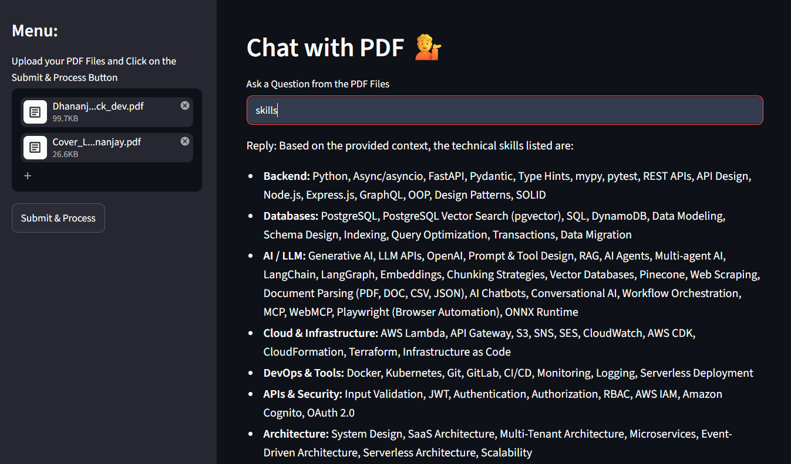
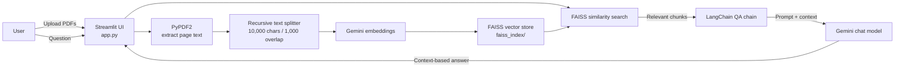

# Chat with PDF

A Streamlit app for asking questions about one or more PDF documents. It extracts PDF text, splits it into overlapping chunks, embeds the chunks with Google Gemini, stores the vectors locally with FAISS, and uses a Gemini model to answer questions using the most similar chunks as context.

## Screenshot



## Features

- Upload and process multiple PDF files in one batch.
- Search document content with Gemini embeddings and a local FAISS vector index.
- Ask natural-language questions and receive answers grounded in retrieved PDF passages.

## Requirements

- Python 3.10 or newer.
- A Google Gemini API key (see [Get a Gemini API key](#get-a-gemini-api-key)).

## Setup and run

1. Clone or download this repository and open a terminal in the project directory.
2. Create and activate a virtual environment:

   ```bash
   python -m venv .venv
   # Windows PowerShell
   .venv\Scripts\Activate.ps1
   # macOS / Linux: source .venv/bin/activate
   ```

3. Install the dependencies:

   ```bash
   python -m pip install -r requirements.txt
   ```

4. Create a `.env` file in the project root and add your key:

   ```dotenv
   GOOGLE_API_KEY=your_gemini_api_key_here
   ```

   Keep `.env` private. It is excluded from Git; never commit or share your API key.

5. Start the app:

   ```bash
   streamlit run app.py
   ```

6. In the browser, upload your PDFs in the sidebar and select **Submit & Process**. Once processing completes, enter a question in the main panel.

## Get a Gemini API key

1. Open [Google AI Studio API keys](https://aistudio.google.com/apikey) and sign in with your Google account.
2. Create an API key (or select an existing key) for a Google Cloud project. Google AI Studio may prompt you to accept the applicable terms or select a project.
3. Copy the key and put it in the `GOOGLE_API_KEY` entry in your local `.env` file as shown above.
4. Restart Streamlit if it was already running so the app loads the new environment variable.

See Google's [Gemini API key documentation](https://ai.google.dev/gemini-api/docs/api-key) for current key and project guidance. Treat the key as a password, restrict it to the Gemini API when configuring restrictions, and review Google's current usage limits and billing terms for your account.

## Architecture



### Request flow

1. `app.py` accepts PDFs through Streamlit and extracts text from each page with PyPDF2.
2. `RecursiveCharacterTextSplitter` divides the combined text into chunks of 10,000 characters with 1,000 characters of overlap.
3. `GoogleGenerativeAIEmbeddings` embeds the chunks, and FAISS saves the resulting local index under `faiss_index/`.
4. For each question, the app loads that index and retrieves the most similar chunks.
5. A LangChain question-answering chain sends the retrieved context and question to the configured Gemini chat model. The prompt asks the model to say when the answer is not present in the supplied context.

## Project files

| Path | Purpose |
| --- | --- |
| `app.py` | Streamlit interface, PDF processing, vector indexing, retrieval, and Gemini question answering. |
| `requirements.txt` | Python dependency pins. |
| `screenshots/app.png` | Application screenshot. |
| `faiss_index/` | Local generated vector index, created when PDFs are processed. |

## Notes

- Process PDFs before asking a question. Processing a new batch replaces the local index saved at `faiss_index/`.
- The current index is local to this checkout and is not a separate index per user or session.
- PDF text extraction depends on selectable text; scanned pages may need OCR before they can be searched.
- The Gemini model and embedding model are configured in `app.py`.
